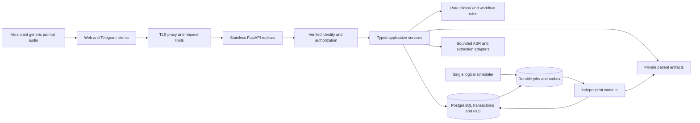

# EnatAI production readiness implementation plan

Prepared 13 October 2026 against repository revision `14975c2`.

**Current status — 15 October 2026:** Phase 4's container blocker is remediated;
local engineering and verification now extend through Phase 5. Hosted CI passes
on a59e999 and `master` requires the `test` and `container` checks. Production release
acceptance is **not complete**: actual staging/Supabase/provider checks, approved
clinical/privacy/retention decisions and named operational owners are still pending.
See [Phase 5 evidence](docs/phase5-operations.md) and the
[operations runbook](docs/operations-runbook.md). The original assessment below
is retained as historical context, not a statement of remaining source defects.

EnatAI is an MVP with useful separation between routes, services, repositories, and deterministic domain functions. It is not ready for production patient use. The immediate blockers are application import defects, incomplete schema migrations, authentication weaknesses, insufficient controls around shared health data, and inconsistent persistence and clinical-data handling.

Retain a modular FastAPI application with Supabase authentication, PostgreSQL, and object storage. Separate scheduled work from API processes and establish explicit transaction, identity, and provider boundaries. A microservice migration is not needed to address the current problems.

This plan covers implementation, verification, deployment, operations, and release criteria. Estimates assume two backend engineers, part-time platform and QA support, and access to a clinical reviewer and privacy/security reviewer. These are proposed responsibilities, not existing staffing commitments. Allow roughly 8–12 calendar weeks, with revision after the first reproducible baseline. Release depends on evidence, not the calendar.

**Assessment limits:** source code, migrations, tests, and repository documentation were reviewed. Live Supabase grants, deployed configuration, provider contracts, production data, and capacity were not inspected. `python3 -m pytest tests -q` stopped before collection because `pytest_asyncio` is missing from the available environment. No test pass rate, coverage, runtime vulnerability scan, or production capacity is claimed. Application code was unchanged at assessment time; implementation progress is recorded below.

## Implementation progress — 13 October 2026

Phase 0 implementation is complete locally. Evidence and remaining schema gaps
are recorded in [the baseline record](docs/production-baseline.md).

- [x] Repair undefined application names and cover imports and the UUID correction branch.
- [x] Declare Python 3.12/Linux and separate hash-locked runtime/development dependencies.
- [x] Add CI dependency/static/test checks, dummy test configuration, network blocking, and lifespan tests.
- [x] Add `.env.example`, deployment modes, production validation, explicit CORS, and default-off development routes.
- [x] Inventory schema drift on fresh PostgreSQL 16 and record external services, buckets, and known consumer evidence.

Verification: **98 tests passed**; dependency consistency and undefined-name checks
passed. Migrations 001–004 apply, but the resulting schema still lacks Telegram
columns and `push_tokens`; RLS policies are absent. Hosted CI has not yet run.

Embedded scheduling now defaults off and is prohibited in staging/production.
Production reminders require the Phase 3 worker. Later phases and their clinical,
privacy, capacity, recovery, and operational release gates remain open. No
production deployment or release approval is implied by this milestone.

## Phase 1 implementation progress — 13 October 2026

The local security implementation and migrations are in place. See
[Phase 1 evidence, client changes, and deployment gates](docs/phase1-security.md).

- [x] Verified signup, generic login/recovery failures, refresh/logout, strict online JWT policy, and explicit time-bounded legacy HS256 support.
- [x] Consolidated fresh Telegram validation, one-use exchange, short-lived opaque sessions, stable identities, and proof-based linking without automatic merges.
- [x] Forward migrations 005–006; patient repositories use a non-owner/non-BYPASSRLS PostgreSQL role, transaction-local identity, RLS, and restricted client/function grants.
- [x] Explicitly consented, hashed-token shares with expiry/revocation, structured allowlist, private QR response, and legacy link invalidation. Sharing remains disabled by default.
- [x] Authenticated POST TTS, no text URLs, no gTTS fallback, bounded generic cache, and no anonymous synthesis on generic cache misses.
- [x] Distributed request/provider limits, bounded uploads/audio/text/items, host/proxy configuration, private headers, redacted errors/access logs, and local/history secret-pattern scanning.
- [x] Local unit tests and fresh/legacy PostgreSQL security integration tests; frontend guide and Postman security contracts updated.
- [ ] Verify actual Supabase Auth recovery/confirmation/key rotation and Storage grants/APIs in staging; audit deployed role memberships and credentials.
- [ ] Review/approve sharing and processor use, retention/export/deletion/incident responsibilities, vendor currency budgets, and frontend/edge/CDN rollout.

Local evidence: **133 unit tests passed**; PostgreSQL **19 fresh-install tests**
and **20 upgrade tests** passed. Lint/dependency checks passed and the secret-pattern
scan reported zero findings.

Phase 1 release acceptance remains conditional on those external checks and
reviews. No live service or production data was changed. Subsequent implementation
progress is recorded below; local test success is not a production release decision.

## Phase 2 implementation progress — 13 October 2026

The local integrity implementation and migration 007 are in place. See
[Phase 2 evidence, migration/client changes, and clinical gates](docs/phase2-integrity.md).

- [x] Typed stage/correction schemas; explicit additions/discards; unknown-ID rejection; server-owned provenance and clinical flags.
- [x] One conservative policy across extraction, corrections, persistence and reports; explicit uncertainty and no blanket mild-category suppression.
- [x] Exact confirmation checks; legacy-unverified markers; confirmation/source/policy/prompt provenance without invented model identifiers or timestamps.
- [x] Session versions, stage status, resume endpoint, provider-result compare-and-save, and early confirmed danger flags.
- [x] Transactional finalization, unique session references, durable terminal responses, outbox events, and scoped retry keys with request-hash conflicts.
- [x] Canonical food/supplement collections, preserved manual meal inputs, and explicit supplement selection.
- [x] Exact report windows, complete retrieval beyond 1,000 rows, retriable database failures, and unknown adherence separated from reported non-adherence.
- [x] Explicit versioned attendance/rescheduling events; reports never advance appointments; UTC persistence and Addis Ababa local dates.
- [x] Database-enforced immutable snapshots, deduplicated automatic generation, atomic snapshot/outbox writes, and independent private QR retries.
- [x] Fresh/legacy database tests, concurrency and failure injection, authenticated workflow tests, and updated frontend/Postman contracts.
- [ ] Clinical approval of policy, Amharic wording, attendance behavior, and a reviewer-labeled ASR/extraction regression corpus.
- [ ] Frontend/staging rollout and migration rehearsal with deployed grants/data; outstanding Phase 1 privacy/security and subsequent operational gates.

Local evidence: **157 unit tests passed**; PostgreSQL **37 fresh-install tests**
(two upgrade-only cases skipped) and **39 upgrade tests** passed. Lint,
dependency consistency, and whitespace checks passed; the secret-pattern scan
reported zero findings. Hosted CI and live provider quality were not evaluated.

This completes local engineering work for Phase 2; its clinical/release acceptance
remains open. Migration 007 expires pre-migration in-progress sessions while
retaining drafts, and requires the coordinated client contract update. Durable
outbox delivery remains Phase 3 work. No deployed migration or production change
was performed.

## Phase 3 implementation progress — 13 October 2026

The local background-work and provider implementation is in place, with migration
008 and separate scheduler/worker entrypoints. See the
[Phase 3 evidence and operations runbook](docs/phase3-resilience.md).

- [x] Removed API scheduling and APScheduler; isolated worker settings and credentials.
- [x] Durable scheduler lease/cursor, bounded pages, stable daily keys, and explicit Addis Ababa catch-up behavior.
- [x] Durable jobs with claim leases, heartbeats, fenced acknowledgement, jittered retries, terminal failures, status and operator replay.
- [x] Per-job isolation, reminder occurrence uniqueness including supplement/appointment identity, and idempotent automatic snapshots.
- [x] Transactional outbox dispatch and repeat-safe in-app notification delivery.
- [x] Shared bounded provider clients, transport and operation deadlines, attempt budgets, distributed admission, circuit protection, and validated responses.
- [x] Recoverable provider-error contract, preserved drafts, and bounded offloading of synchronous database/storage I/O.
- [x] Versioned generic prompt URLs, explicit operator provisioning workflow, bounded approved-asset cache, and no synthesis on public misses.
- [x] Unit and fresh/legacy PostgreSQL acceptance tests, including concurrency, rollback, and real worker-process death/restart.
- [ ] Staging process/credential/grant rehearsal, prompt generation/review/upload and CDN checks, provider billing/latency verification, frontend recovery rollout, and monitoring alerts.

Local evidence: **182 unit tests passed**; PostgreSQL **49 fresh-install tests**
(two upgrade-only cases skipped) and **51 upgrade tests** passed. Lint,
dependency consistency, and whitespace checks passed; the secret-pattern scan
reported zero findings. Both hash-locked dependency sets were regenerated from
the local resolver cache, and the development environment was synchronized.

This completes local engineering work for Phase 3. Staging acceptance, all earlier
clinical/privacy gates, and later operational release gates remain open. No live
provider, deployed migration, or production storage change was performed.

## Phase 4 implementation progress — 13 October 2026

Quality and verification gates are implemented locally. See
[Phase 4 evidence and gate policy](docs/phase4-verification.md) and
[security remediation](docs/security-remediation.md).

- [x] Repository-wide formatter/linter/import checks and strict typing for settings, models, clock/errors and provider boundaries.
- [x] Typed provider envelopes and onboarding inputs, recursive JSON collections, domain/repository/artifact errors and a common redacted HTTP error contract.
- [x] Removed unused public-QR helpers and blanket service fallbacks; onboarding and unified settings now commit or roll back together.
- [x] Full HTTP onboarding → audio → correction/confirmation → early warning → completion → summary → share → revoke journey against real PostgreSQL.
- [x] Slow-provider state reads, lost-response/reconnect/replay without duplicate provider calls, and late-write rollback tests.
- [x] Fresh and synthetic legacy migration suites, existing safety/ownership/concurrency/job acceptance cases, and contract-gate regression tests.
- [x] Generated OpenAPI and operation inventory, Postman schema/auth/header checks, and reconciled README/frontend instructions.
- [x] Locked runtime/development dependency audits, source/history scans, runtime CycloneDX SBOM, and CI report retention.
- [x] Removed vulnerable python-jose/ecdsa dependencies; PyJWT parsing retains mandatory online Supabase verification.
- [x] Added non-root image, isolated runtime smoke test, pinned container scanner/SBOM generation, and a fail-closed high/critical gate.
- [x] Completed local image build, non-root runtime smoke, container vulnerability/secret scan and image-specific SBOM/findings archive.
- [x] Remediated on 14 October: replaced the rejected Debian runtime with a digest-pinned Alpine 3.24 candidate; final scan has zero HIGH/CRITICAL findings, without exceptions. Historical 213 package findings are archived separately.
- [x] Observe passing hosted CI and configure required branch checks (15 October, a59e999; details in Phase 5 evidence).
- [ ] Complete outstanding clinical/privacy/staging and Phase 5 operational release gates.

Local application evidence: **203 unit tests passed**; PostgreSQL **53 fresh-install
tests** (two upgrade-only skips) and **55 upgrade tests** passed. Strict mypy
passes **12 source files**, and **54 Postman examples** match the generated API
contract. Runtime/development dependency audits report zero known vulnerabilities.
Those are the original 13 October test counts. The container gate was subsequently
fixed and now passes; current evidence is below and in
[the image-specific report](docs/container-security-findings.md). Hosted CI now
passes; the external release checks remain unobserved. No vulnerability exception or
production release approval was granted.
No production service or patient data was changed.

## Phase 5 implementation progress — 15 October 2026

- [x] Patched non-root image, bounded resource/deployment templates, separate API/worker credentials, two API instances and graceful shutdown.
- [x] Serialized, checksum-verified migration runner with atomic applied records, failure SQLSTATEs and retry/drift/concurrent-run tests; additive migration 009.
- [x] Independent liveness, bounded database/schema readiness, and bounded abandoned-probe work; provider failure remains separate.
- [x] Structured redacted logs, server request IDs (including early failures), job IDs, sampled OTLP traces through providers/outbox, private bearer-protected API/worker metrics.
- [x] Dashboard and alert configurations; actual private Prometheus scrapes of both APIs/worker/scheduler, 13 dashboard queries, outage notification to a local test sink, and missing-target/outage/job alert regression tests. Human notification delivery remains external.
- [x] Default-50/max-100 cursor pages for history, reminders, notifications and supplements; explicit internal report pages, deterministic ties, cross-user cursor tests and measured history index plan.
- [x] Two 30-minute synthetic 50-request/second rehearsals with 1,000 users, 100,000 history rows, reads/writes and forced instance loss. The first failed p99 and is retained; the diagnostic repeat passed p95 21 ms/p99 32 ms with 3 transport errors in 90,000 requests and both instances recovered.
- [x] Rehearsed the actual Compose deployment with staging configuration validation, separate restricted roles, migration container, non-root/read-only/resource limits and exactly-once scheduler/worker outbox delivery. The one-CPU API configuration failed sustained-loss p99 (1.708 seconds); its evidence is retained.
- [x] Full Compose repeat passed with two CPUs per API, unchanged 512-MiB limits/pools and independent readiness checks: 90,000 requests at 50/second over 30 minutes, p95 25 ms/p99 48 ms, 13 transport errors (0.0144%), and recovery after a 150-second API outage. All four scrapes, local alert receipt, 13 dashboard queries and exactly-once outbox delivery pass. Temporary services/network/database were removed.
- [x] AES-256-GCM database/object backups, one exported database snapshot, artifact hashes/references, authenticated restore and refusal of occupied restore targets; synthetic corruption/restore/grant checks pass.
- [x] Candidate forward/rollback/forward rehearsal across two retained clean image digests, keeping schema 009 and the same owned record.
- [x] Bounded scheduler cleanup of expired credentials and expiration of stale drafts without erasing clinical records; deployment, recovery, outage, replay, rotation, correction and incident runbooks.
- [ ] Execute the prepared deployment, rollback, alert-delivery and managed PITR/object-restore rehearsals on the actual staging infrastructure and configured resource limits.
- [ ] Verify live Supabase grants/Auth/Storage, real-provider Amharic quality/latency and currency budgets, and coordinated frontend rollout.
- [ ] Obtain clinical/privacy approval, retention/deletion/export policy and accountable primary/backup responders. Clinical retention purge remains intentionally unimplemented until that policy is supplied.
- [x] Repair hosted-run failures locally: importlib collection and package-qualified fixtures pass 208 unit/HTTP, 60 fresh-database and 62 upgrade tests. Independently scheduled fault injection and a 120-second Compose check pass 6,000 requests, p95 68 ms/p99 121 ms, with 10 transport failures (0.1667%) and successful recovery. Previous failed results remain recorded.
- [x] Hosted CI [run 38764968793](https://github.com/Welu2/enat-backend/actions/runs/38764968793) passes on a59e999, including both two-minute load/recovery checks and security gates. Compose p95 14 ms/p99 17 ms with 12/6,000 transport errors (0.2%). `master` now requires up-to-date GitHub Actions `test` and `container` checks, including administrators; saved settings verified. The manual full-capacity job was skipped on this push, and earlier full local evidence remains separately recorded.
- [ ] Approve an actual release/rollback digest and supervised pilot.

Local verification: **208 unit tests**, **60 fresh database tests** (2 legacy-only
skips), **62 upgrade tests**, strict mypy (12 files), Ruff, 54 generated client
contract examples, secret/source/dependency audits, final container smoke and
zero HIGH/CRITICAL container findings. The local rollback uses two candidates
from this session, not an approved historical production release.

The remaining unchecked items are release acceptance dependencies, not successful
checks. No staging/production service, patient data or external account was changed.

## Findings that drive the implementation order

P0 blocks any production patient use. P1 must be complete for a supported production release. P2 improvements follow measured pilot demand. File locations below refer to the reviewed revision.

| ID | Priority | Repository evidence | Consequence and required response |
|---|---|---|---|
| F01 | P0 | `app/dependencies.py:14` references undefined `settings`; line 117 uses unimported `Depends`. `app/services/checkin_session.py:128` uses unimported `uuid4`. | The authentication module cannot import as written; some correction paths also fail. Repair names and introduce import/startup and branch tests immediately. |
| F02 | P0 | `app/db/repositories/users.py:31` expects `telegram_id`, `first_name`, and `username`; `push_tokens.py:19` accesses `push_tokens`. None is created by migrations 001–004. | A database built from the repository cannot support these paths. Add forward migrations and test a fresh installation plus upgrade. |
| F03 | P0 | `app/api/routes/auth.py:24` creates users with `email_confirm=True`; line 68 auto-confirms on login. | Email ownership is not established. Replace this with a deliberate verified signup/recovery lifecycle and generic authentication errors. |
| F04 | P0 | `app/dependencies.py:19` and `app/api/routes/telegram.py:6` validate HMAC but do not validate `auth_date`; the bot token defaults to empty. | Signed credentials have no application freshness bound. After repairing imports, reject Telegram auth when unconfigured, validate freshness, and consolidate the duplicate validators. |
| F05 | P0 | `app/db/client.py:11` uses the service-role key; migration 001 enables RLS without policies; migration 004 does not enable RLS on `stage_audio_prompts`. | Request isolation primarily depends on application filters. Define least-privilege grants and tested database isolation; inspect live grants before asserting any direct exposure. |
| F06 | P0 | `app/config.py:20` enables dev routes by default; `app/main.py:80` exposes unauthenticated ASR; `app/api/routes/reminders.py:17` exposes the job trigger. | A default deployment permits costly provider calls and global job execution. Production must exclude these routes and reject unsafe configuration. |
| F07 | P0 | `app/api/routes/summary.py:29` serves unauthenticated `GET /summary/{share_link_slug}`; `summaries.py:33` has no expiry/revocation check; `services/summary.py:260` includes raw text; `services/qr.py:27` uploads to a public QR bucket. | Possession of a link or QR conveys access to sensitive content indefinitely. Raw patient text cannot be assumed de-identified. Introduce consent, scoped expiring shares, revocation, and private QR delivery. |
| F08 | P0 | `app/api/routes/tts.py:37` puts text in URLs; line 127 logs it on failure. `app/services/addis_ai.py:137` sends text to gTTS on fallback. | Patient text can reach URL/access logs and an additional processor. Remove patient text from URLs/logs and make every external data route explicit and approved. |
| F09 | P0 | `app/services/checkin_session.py:258` inserts a check-in then separately marks the session complete; repository updates have no version condition. | Concurrent requests or a crash can create duplicates or overwrite newer corrections. Add atomic finalization, version checks, and retry-safe mutations. |
| F10 | P0 | `app/models/checkin.py:55` accepts arbitrary correction dictionaries; `checkin_session.py:158` merges them; lines 140 and 206 substitute a different item when an ID does not match. | Corrections can alter unexpected fields or affect the wrong item. Use typed stage-specific corrections and exact identity checks. |
| F11 | P0 | `app/services/extraction.py:327` and `checkin_session.py:161` clear every category with severity `mild`; `summary.py:231` accepts missing confirmation; food lists at line 282 lack confirmation filtering. | Clinical interpretation and confirmation rules are not consistently enforced. Obtain clinical review and establish one versioned policy; require explicit confirmation in finalized data and summaries. |
| F12 | P0 | `app/services/summary.py:65` falls back to all user records on an empty/failed period query; `checkin_session.py:331` overwrites food/supplement items; `summary.py:179` advances appointments during report generation. | Reports may cover an unintended period, lose items, or move appointments before a visit occurs. Correct these behaviors and add realistic regression cases. |
| F13 | P1 | `app/main.py:22` starts a scheduler in each API process; `services/reminders.py:27` loops through all users; deduplication uses separate existence checks and inserts. | Replicas can duplicate work; one user failure can interrupt the batch. Introduce a separate scheduler, durable jobs, database uniqueness, and per-user failure isolation. |
| F14 | P1 | Async check-in services directly call synchronous repositories; `services/addis_ai.py:20` creates a new HTTP client per call; history and job scans have no explicit pagination. | Event-loop blocking, connection churn, and database response caps constrain throughput and completeness. Bound work and measure latency before choosing capacity. |
| F15 | P1 | `app/db/repositories/push_tokens.py:27` returns a success-shaped payload after any database error; `services/summary.py:74` suppresses query errors; auth/TTS routes expose exception text. | Failures can look successful or leak implementation details. Add typed errors, explicit degraded states, and redacted telemetry. |
| F16 | P1 | `requirements.txt` contains only lower bounds and mixes test/runtime dependencies. No CI workflow, container definition, or dependency lockfile is checked in. `/health` returns a constant success. | Builds and release verification are not reproducible; readiness and recovery are not demonstrated. Establish delivery and operations gates. |
| F17 | P1 | README environment names differ from settings; README documents `/summary/public/{slug}` but code uses `/summary/{slug}`; `stage_audio.py:25` embeds a project URL. | Setup and client behavior depend on undocumented assumptions. Generate accurate contracts and remove environment-specific fallbacks. |

The service-role concern is specific: Supabase service-role access bypasses RLS, so merely enabling RLS does not constrain these backend requests. Define both grants and policies, then test the exact production roles. [Supabase RLS documentation](https://supabase.com/docs/guides/database/postgres/row-level-security).

## Target architecture and boundaries

- **Routes** parse and validate requests, resolve identity, call a use case, and map typed errors. They do not instantiate repositories or implement clinical policy.
- **Application services** coordinate transactions and external work through injected interfaces. Inject a clock, repositories, provider clients, and job publisher so failure paths are testable without live services.
- **Domain functions** own confirmation, stage transitions, date windows, and approved clinical rules. They do not import HTTP, database, or speech-provider code.
- **Infrastructure adapters** own Supabase/Auth/Storage clients, SQL operations, timeouts, retry budgets, and telemetry. Move TTS URL construction out of extraction code and remove imports of another module's private helpers.
- **API and workers** deploy from the same versioned codebase with different entry points and credentials. Start with one logical scheduler and a PostgreSQL-backed job/outbox design; adopt a dedicated broker only if measurements justify it.

Record these decisions before implementation: identity mapping across email and Telegram, database authorization, summary-sharing policy, clinical rule ownership, and job delivery semantics. Preserve existing HTTP paths until client migration is coordinated; additive fields and explicit deprecation are safer than a broad rewrite.

For database authorization, use a backend-only, non-`BYPASSRLS` application role with a verified internal user ID set transaction-locally by the server. Policies use that trusted context; clients never receive database credentials or choose the context. Use a separate, narrowly privileged worker role. Keep Supabase Auth and Storage integrations separate from this data role. Validate this approach in staging before migrating repositories. An alternative based on Supabase user JWTs is acceptable only if it also establishes a trusted identity for Telegram users; adding `auth.uid()` policies alone does not solve that mapping.

## Phase 0 establish a reproducible baseline

**Priority:** P0. **Proposed owner:** backend lead. **Effort:** 2–4 engineer-days. **Dependencies:** none.

1. Repair undefined names in F01. Centralize `get_settings()` and import `Depends` and `uuid4` where needed. Remove module-level configuration mistakes without changing authentication semantics incidentally.
2. Choose and declare one supported Python version; resolve and lock dependencies in an isolated environment. Separate runtime and development/test dependencies. Capture the first full test result before making broad changes.
3. Add minimal CI for dependency installation, undefined-name/static checks, application import, startup/shutdown, and the existing tests. Tests must use explicit dummy configuration and block unintended outbound requests.
4. Add `.env.example` using actual setting names. Introduce environment modes and production startup validation. Default dev routes off; exclude ASR/job debug routes from the production router.
5. Inventory schema drift against migrations in an isolated environment. Record external services, environment variables, storage buckets, and current API consumers.

**Acceptance:** a fresh checkout starts with documented test configuration; production mode has no dev endpoints; all tests collect; existing failures are repaired or explicitly tracked as release blockers. No live credentials are required for unit tests.

## Phase 1 secure identities and health data

**Priority:** P0. **Proposed owners:** backend and security/privacy reviewers. **Effort:** 10–15 engineer-days. **Dependencies:** Phase 0 baseline; identity and sharing decisions.

1. Replace admin-created, automatically confirmed signup with the supported verified signup flow. Remove login auto-confirmation. Specify refresh/logout behavior, recovery-token handling, account linking, and disabled-account behavior. Verify recovery through integration tests rather than relying on the current custom client options.
2. Use one explicit JWT verification policy. Validate issuer, audience, expiry, subject, and allowed algorithms; support key rotation deliberately. Distinguish provider unavailability from invalid credentials. Do not fall back to weaker or legacy verification merely because the Auth API failed. If legacy HS256 must remain during migration, make it explicit and time-bounded.
3. Consolidate Telegram verification, reject an empty bot token, reject malformed/duplicate parameters, require valid `auth_date`, and bound age and future clock skew. Proposed starting values are five minutes and 30 seconds, subject to client validation. Exchange validated launch data for a short-lived application session; prevent repeated exchanges from extending a stolen launch payload indefinitely. [Telegram validation documentation](https://core.telegram.org/bots/webapps#validating-data-received-via-the-mini-app).
4. Create a stable internal user identity with a unique provider/subject mapping. Link identities only after proving control of both accounts. Add Telegram fields or a normalized identity table through a forward migration, preserving existing IDs and ownership.
5. Implement the chosen database role and RLS model. Inventory table, function, and storage grants. Revoke client access to backend-only data. Permit anonymous reads only for intentionally public generic prompt assets; deny their public modification. Test user A, user B, anonymous, worker, and admin roles separately.
6. Introduce a separate `summary_shares` record with summary ID, owner, token hash, expiry, revocation, and scope. Require explicit share creation; provide revocation. Use cryptographically random tokens, store only their hashes, and redact tokens from logs. Set `Cache-Control: no-store`, `Referrer-Policy: no-referrer`, and indexing restrictions on the relevant API/frontend pages. Make patient QR assets private. Coordinate frontend changes and invalidate or explicitly migrate old links before release.
7. Define allowed share fields and review free text for identifying content. Do not label removal of user ID/email as anonymization. Decide whether clinician authentication is required or whether time-limited patient-controlled bearer sharing meets the product's approved access model.
8. Replace patient-specific TTS query text with authenticated POST or an opaque, short-lived audio handle suitable for playback. Public generic prompts can remain public. Disable automatic transmission of patient text to fallback processors until their use is approved. Define consent, retention, deletion/export, processor access, and incident responsibilities with the appropriate reviewers.
9. Add distributed limits for login/recovery, uploads, extraction, TTS, summary generation, and share lookup. Enforce body/text/item limits, provider concurrency and spend budgets, and bounded cache bytes/TTL. Validate audio format and duration before provider calls; stream-count uploads instead of reading arbitrary files fully into memory. Return documented `413`, `415`, and `429` responses. These controls address the resource categories in [OWASP API4](https://api-security.owasp.org/editions/2023/en/0xa4-unrestricted-resource-consumption/).
10. Make CORS an explicit environment allowlist. Add trusted proxy/host configuration and centralized redacted errors. Scan tracked code/history and build artifacts for secrets; rotate any confirmed exposed credentials through the normal secret-management process.

**Acceptance:** cross-user access fails for every resource; unconfigured/stale/forged Telegram inputs fail; email ownership cannot be bypassed; expired or revoked shares fail; logs contain no health text, credentials, or share tokens; oversized requests are rejected before provider work; recovery and identity linking have positive and negative tests.

## Phase 2 make clinical workflows and persistence correct

**Priority:** P0. **Proposed owners:** backend engineers and clinical reviewer. **Effort:** 12–18 engineer-days. **Dependencies:** baseline and trusted identity model; clinical review starts in Phase 0.

1. Define typed schemas for each stage, correction, duration, category, and severity. Allow only patient-editable fields. Server code owns IDs, confirmation provenance, rule version, and danger flags. Reject unknown item IDs instead of silently substituting another item. Make manual addition an explicit operation.
2. Establish one clinical policy for extraction normalization, manual corrections, voice corrections, persistence, and summary generation. The broad `mild` suppression rule needs clinical review before release. Preserve uncertainty explicitly; failure to transcribe or classify must not become a reassuring result. Evaluate Amharic negation, ambiguity, code switching, background noise, and corrections with clinician-reviewed examples.
3. Persist only explicitly confirmed items. Require `confirmed is True` in summary inclusion rules. Define treatment of legacy rows with missing confirmation; quarantine or mark them unverified rather than manufacturing confirmation. Record source item, confirmation time, and rule/prompt/model versions where available.
4. Add session `version`, terminal result reference, and explicit stage status. Reject stale mutations with `409`. Read state before a provider call and compare its version when saving the result so slow transcription cannot overwrite a newer correction or stage transition. Do not hold database locks during network calls.
5. Finalize in one transaction: lock/validate the session, validate confirmed content, insert the check-in with a unique `session_id`, mark the session completed, and persist any outbox events. Return the existing result on a repeated completion. Inject failures between steps and prove rollback.
6. Add idempotency keys to retryable mutations. Scope keys by identity and operation, store a request hash and committed result, and reject key reuse with a different request. Session uniqueness remains an independent protection when clients omit or lose a key.
7. Preserve multiple food and supplement items using a canonical collection schema. Migrate existing singleton JSON values and update responses with a coordinated compatibility path. Do not infer an unknown supplement as the first configured supplement without explicit verification.
8. Fix summary date windows: an empty requested period remains empty; a database error produces a retriable failure; neither falls back to all history. Retrieve all pages within the exact window and distinguish unknown adherence from reported non-adherence.
9. Separate report creation from appointment attendance and advancement. Generating a pre-visit report must not consume the upcoming appointment. Define explicit completed, missed, and rescheduled transitions with client behavior and reviewer approval.
10. Make snapshots immutable through database privileges/constraints, not only repository conventions. Keep mutable share and delivery state separate. Use unique automatic-generation keys per user, reason, and period/contact. Commit snapshot/outbox state together and generate QR artifacts after commit; retry failed artifacts independently.
11. Use timezone-aware UTC instants and an explicit local date policy, initially `Africa/Addis_Ababa` if that matches the supported population. Inject the clock. Preserve original `users.created_at` on login instead of resetting it in `UserRepository.upsert`.
12. Add missing push-token schema or explicitly disable the feature. Replace success-shaped error fallbacks with durable success or a typed error. Define token ownership transfer on logout/device reuse so registration cannot silently reassign another user's token.

**Acceptance:** concurrent completion creates exactly one check-in; stale provider results never overwrite confirmed work; all verified food/supplement items survive; unconfirmed and out-of-window data never enter reports; report generation leaves appointment status intact; clinical regression cases have reviewer-approved expected outcomes.

## Phase 3 make background work and integrations resilient

**Priority:** P1. **Proposed owner:** backend/platform engineer. **Effort:** 8–12 engineer-days. **Dependencies:** Phase 2 transactions and uniqueness.

1. Remove `BackgroundScheduler` from API lifespan. Use a separate scheduler to enqueue due work, with a database lease or equivalent mechanism for one logical scheduler and recovery after failure.
2. Implement durable jobs with identity, deduplication key, due time, attempt count, lease expiry, heartbeat, and terminal status. Assume delivery can repeat: handlers must be idempotent. Add exponential backoff with jitter, maximum attempts, a failed-job queue, and an operator replay procedure.
3. Query due users/work in bounded pages. Isolate failures by user/job. Use unique reminder keys including user, reminder type, related supplement/appointment, and scheduled occurrence; two supplements at the same time must not suppress each other.
4. Define scheduling timezone and missed-run catch-up behavior. Retain pending work across restarts and make scheduler lag measurable.
5. Reuse bounded provider HTTP clients over application lifespan. Configure connection, read, write, and pool timeouts plus a total operation deadline. Bound retry multiplication across extraction retries and HTTP retries. Retry only appropriate transient failures and account for duplicate provider charges.
6. Validate provider payloads and audio responses. A JSON error body must not be returned as successful audio. Add provider concurrency caps, outage protection, and explicit retry/manual-input states. Provider outages must preserve the patient's draft.
7. Eliminate synchronous database I/O directly inside async services. Use async repository adapters where practical; use a bounded thread pool as a transitional measure. FastAPI does not automatically offload ordinary helper calls made inside async services. [FastAPI concurrency documentation](https://fastapi.tiangolo.com/async/).
8. Pre-generate versioned generic prompts and serve them from object storage/CDN. Cache only approved data with a byte limit, TTL, and tenant-safe keys. Avoid dynamic cache misses causing unlimited synthesis.

**Acceptance:** two API replicas create no duplicate scheduled work; worker termination causes retry without duplicate domain effects; one failed user does not block the batch; simulated provider timeouts/429/5xx/malformed responses leave recoverable state and respect the total deadline.

## Phase 4 establish code quality and verification gates

**Priority:** P1. **Proposed owner:** backend/QA lead. **Effort:** 7–10 engineer-days. **Dependencies:** baseline; develops alongside Phases 1–3.

1. Add formatter/linter and type checks for changed application boundaries. Replace unstructured `dict[str, Any]` where it crosses trust or persistence boundaries; pure JSON storage does not require abandoning typed models.
2. Introduce domain/repository/provider exceptions and one HTTP error mapper. Remove blanket exception suppression and introspection-based compatibility fallbacks from production paths. Keep intentional compatibility in named, tested adapters.
3. Expand tests by risk: startup; signup/login/recovery; Telegram freshness; every ownership boundary; RLS; missing confirmation; malformed corrections; simultaneous mutations; provider failure; timezone boundaries; summary immutability; share expiry/revocation; job retry and deduplication.
4. Run database integration tests against an isolated migrated PostgreSQL/Supabase environment. Unit mocks cannot prove policies, constraints, transactions, pagination completeness, or migration compatibility. Exercise both fresh install and upgrades with representative synthetic legacy rows.
5. Add an end-to-end test for onboarding → check-in → correction → confirmation → completion → summary → share → revoke. Add a slow-network retry case with reconnect/session resume and a clinical warning flow that does not depend on finishing unrelated stages.
6. Scan locked dependencies, containers, and code; generate a software bill of materials and track remediation. No reachable unresolved critical/high issue should pass the launch gate; any accepted exception needs a named accountable owner and expiry.
7. Generate OpenAPI/client contract checks. Reconcile README, frontend guide, and Postman collection with actual paths, environment variables, pagination, errors, and confirmation behavior.

**Acceptance:** CI blocks import/type/security/contract regressions; meaningful integration and end-to-end tests pass without production services; critical safety and authorization branches have explicit tests. Coverage is supplementary evidence, not a substitute for these cases.

## Phase 5 deliver and operate a measurable production service

**Priority:** P1. **Proposed owner:** platform engineer with backend support. **Effort:** 8–12 engineer-days. **Dependencies:** stable APIs and worker model; infrastructure preparation can start earlier.

1. Add a reproducible non-root container, locked dependencies, graceful shutdown, and resource limits. Deploy independently configured API and worker processes. Separate development, staging, and production projects, credentials, and storage.
2. Add a tracked migration runner with serialized execution and failure detection. Use expand/backfill/validate/contract changes; rehearse against a copy containing synthetic legacy cases. Build new indexes using an approach appropriate for existing table size. Roll back application images without requiring destructive schema rollback.
3. Add liveness and bounded readiness endpoints. Readiness reflects critical local/database availability and schema compatibility. Expose speech-provider degradation separately so a provider outage does not unnecessarily restart healthy APIs or disable history access.
4. Emit structured, redacted logs with request/job IDs, distributed traces, and metrics for request latency/errors, event-loop lag, database pool use, job age/failures, provider latency/errors, confirmation failures, share activity, and cost. Do not use patient text or identifiers as high-cardinality metric labels.
5. Add stable cursor pagination, initially default 50/max 100 for history and similar lists. Page internal scans explicitly, including scans beyond the database API response cap. Inspect query plans with production-shaped synthetic data; preserve useful existing indexes and add measured indexes for jobs, session expiry, and foreign-key lookups.
6. Test the initial capacity envelope below, including cold caches and restart conditions. Scale stateless APIs and workers separately within provider and database limits. Start with at least two API replicas if the chosen availability target requires instance-failure tolerance; select pool/worker counts from measurements.
7. Configure encrypted backups and point-in-time recovery where supported. Define independent handling for object storage. Perform an isolated restore and prove that database rows and referenced artifacts are consistent. Set up rotation, access review, retention deletion, and expired-session/share cleanup jobs.
8. Write runbooks for provider outage, failed jobs, slow database, credential rotation, data correction, compromised share links, rollback, restore, and suspected data exposure. Assign an on-call primary and backup before admitting production users.

**Acceptance:** staging deployment, migration, rollback, instance failure, and backup restoration are demonstrated; dashboards and actionable alerts work; capacity targets pass; responders can recover the service using the runbooks.

## Proposed capacity and service objectives

These are planning inputs to approve and measure during Phase 0, not current guarantees. Revise them for actual user counts, hosting budget, provider quotas, and audio duration distributions.

| Area | Initial target | Validation |
|---|---|---|
| Pilot workload | 1,000 daily active users, four 60-second voice submissions each; 10× average peak concentration | 4,000 submissions/day is about 0.046/sec average and 0.46/sec at assumed peak. A 20-second processing duration implies roughly 9.3 concurrent submissions; test at least 20 concurrent audio operations with bounded queues. Recalculate using measured provider latency. |
| Normal APIs | p95 ≤500 ms and p99 ≤1 second for bounded non-provider reads/writes at 50 requests/sec in a 30-minute synthetic mixed workload | Include authenticated requests and history pagination; record hardware, dataset, error rate, and connection limits. |
| Voice processing | Candidate p95 ≤20 seconds after upload, with an explicit total timeout and recoverable draft | Test representative Amharic recordings against an approved provider test account. If this cannot be met, introduce `202` operation IDs and polling/resume with coordinated frontend changes. |
| Availability | Candidate 99.9% monthly for core API journeys; measure voice/provider success separately and as an end-user journey | Synthetic checks plus real request outcomes; provider failures remain visible even when the core API is available. |
| Jobs | 99% of due work starts within five minutes; no lost committed jobs | Backlog, restart, retry, and scheduler catch-up tests. |
| Recovery | Candidate recovery point ≤15 minutes; recovery time ≤60 minutes | Timed restore of database and necessary object artifacts. Adjust to supported backup facilities and approved cost. |
| Integrity | Zero cross-user disclosures, duplicate session finalizations, or unconfirmed report items in the release suite | Adversarial authorization and database concurrency tests; any failure blocks release. |
| Cost | Per-user and global daily provider budgets, with alerts before exhaustion | Measure calls, audio minutes, retries, cache behavior, and storage. Define actual currency limits after provider usage is measured. |

Do not add database replicas, partitioning, Kubernetes, or separate domain services until measured limits and operating capacity justify their complexity. First address blocking I/O, unbounded scans, unnecessary provider calls, and transaction correctness.

## Delivery sequence and release gates

| Window | Work and dependency | Required exit evidence |
|---|---|---|
| Week 1 | Phase 0, clinical/privacy decisions, baseline CI | Reproducible build and test collection; startup repaired; unsafe dev defaults removed; scoped backlog agreed. |
| Weeks 2–4 | Phase 1 and Phase 2 after identity/schema decisions | Authentication/isolation tests; approved sharing model; transactional completion; correct report windows and confirmation rules. |
| Weeks 4–6 | Phase 3; Phase 4 continuously | Durable job failure tests; bounded provider behavior; concurrency and database integration suite. |
| Weeks 6–8 | Phase 5 and full release verification | Staging release, load results, restore/rollback evidence, redacted monitoring, operational ownership. |
| Weeks 8–12 if needed | Remediation, supervised pilot, capacity adjustment | Pilot outcomes reviewed; all blockers closed; explicit release decision by accountable owners. |

Suggested initial pull requests, each with focused tests and migration/compatibility notes:

1. **Restore startup and CI:** F01, dependency baseline, environment template, import tests.
2. **Remove unsafe production defaults:** F06, production config validation, error redaction, initial request bounds.
3. **Repair identity and schema:** F02–F05, verified signup, Telegram freshness, database isolation tests.
4. **Protect summaries and speech data:** F07–F08, share lifecycle, private QR delivery, frontend playback changes.
5. **Make check-in updates atomic:** F09–F10, versions, typed correction, idempotency, concurrent tests.
6. **Repair report and clinical-data behavior:** F11–F12, explicit confirmation, multiple items, exact periods, appointment transitions.
7. **Separate jobs and bound providers:** F13–F15, outbox/worker, retry controls, async I/O, failure tests.
8. **Complete delivery and operations:** F16–F17, contracts, containers, monitoring, load and restore evidence.

Production release requires all of the following:

- P0 findings closed and P1 acceptance criteria demonstrated; open issues have owners and cannot undermine safety, isolation, or recovery.
- Clean migrations on fresh and upgraded databases, with audited grants and no unreviewed manual production schema dependencies.
- Passing authorization, confirmation, concurrency, provider-failure, and full patient-journey tests.
- Clinical reviewer approval of rule behavior, warning timing, uncertainty handling, ANC transitions, and Amharic regression examples. Preserve deterministic rules while acknowledging that their inputs still depend on ASR/extraction accuracy.
- Privacy/security review of sharing, processor data flows, consent/retention, and deployment access; applicable obligations resolved for the actual operating jurisdictions and service model.
- Measured capacity, cost limits, actionable alerts, successful restore/rollback rehearsal, and assigned responders.
- A small supervised pilot with client compatibility verified; progressive expansion only after reviewing operational and clinical-data incidents.

The first implementation milestone is a clean, secure, reproducible application baseline. Horizontal scaling follows proven data integrity and authorization.
